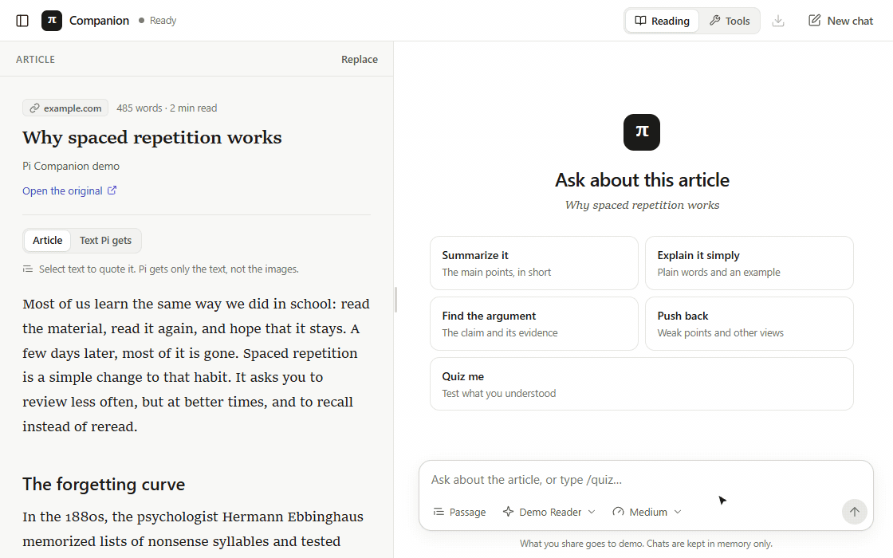
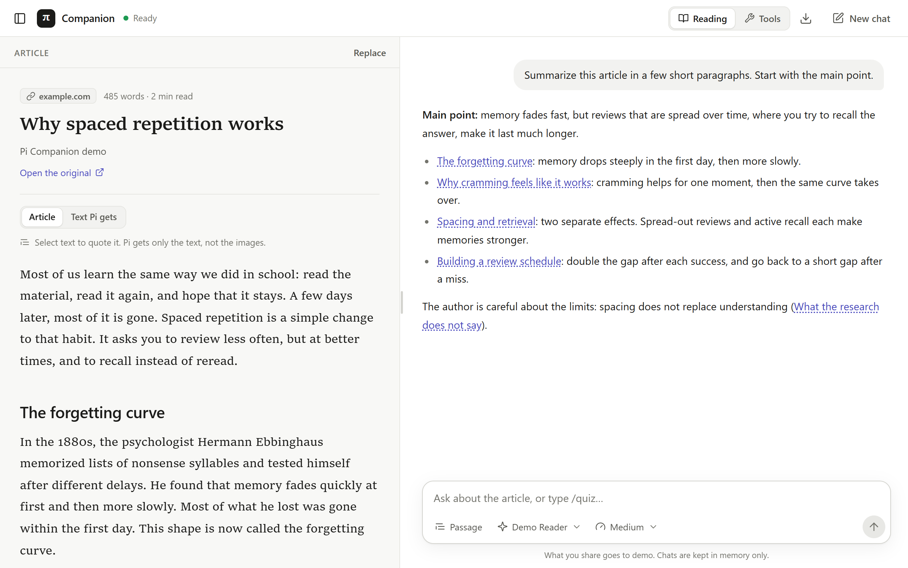
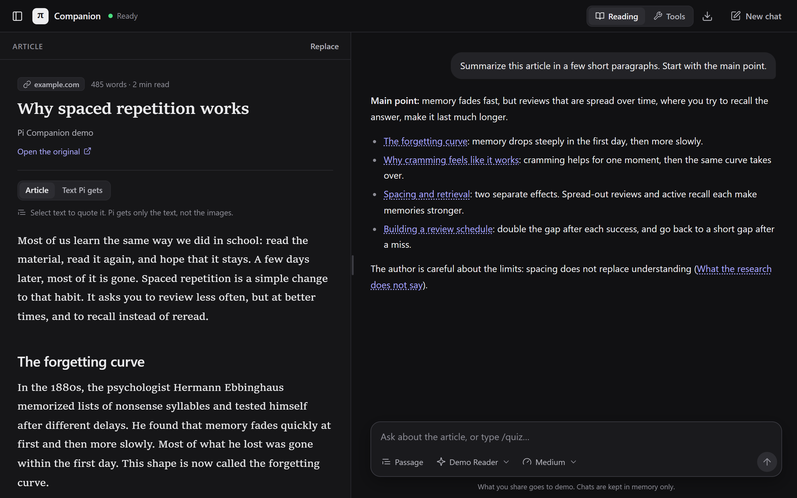
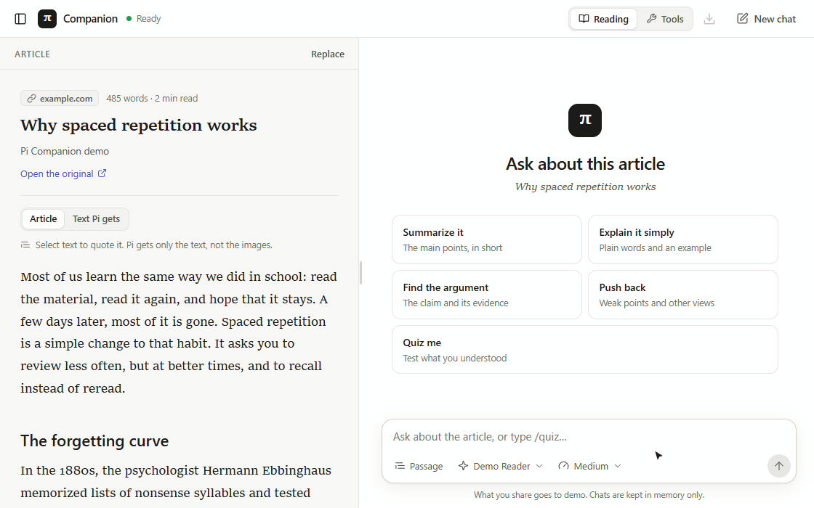
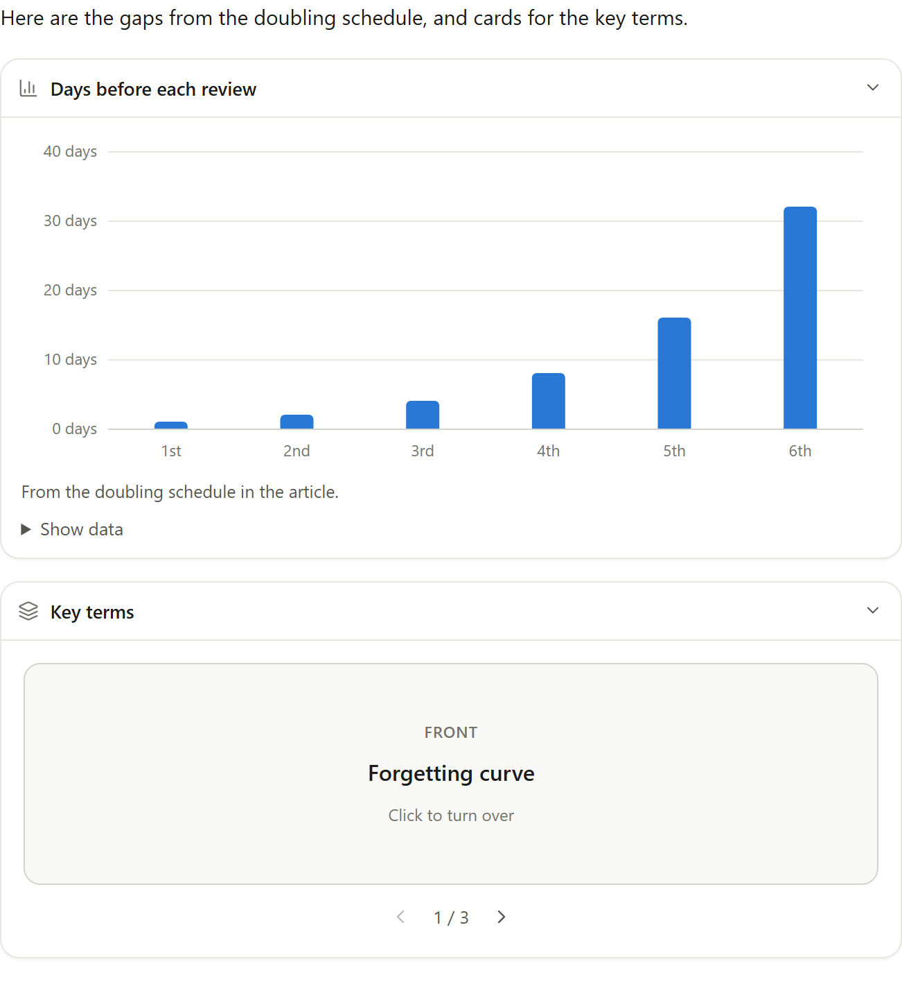
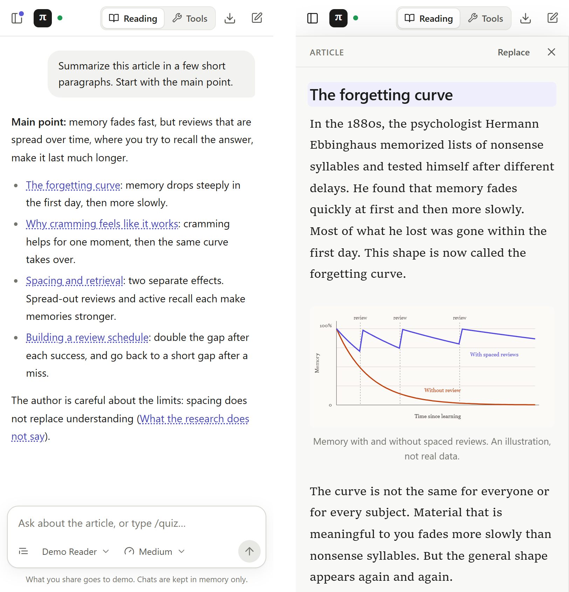
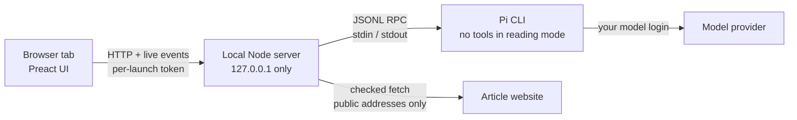

<div align="center">


# Reading Companion

**Read an article with an AI companion next to it.**<br>
A local web app for Chrome, Chromium and Brave. Your installed [Pi](https://www.npmjs.com/package/@earendil-works/pi-coding-agent) agent runs behind it.

[](LICENSE)




</div>

## What it does

- 📖 **Reads with you.** Add a link or paste text. The article shows in a clean reader next to the chat, with its headings, images, tables and code.
- 🔗 **Answers point back to the text.** Pi links to the headings that it talks about. Click a link to go to that part of the article.
- ✍️ **Quotes a passage.** Select text in the article, then click **Quote in chat**.
- 🧠 **Tests what you understood.** Type `/quiz`. Then ask for more questions on your mistakes, an explanation, or harder questions.
- 📊 **Draws widgets.** Charts, steps, quizzes and flashcards, drawn by the app from data. Custom HTML widgets run in a locked frame.
- 🔒 **Stays on your computer.** The server listens only on `127.0.0.1`. Chats stay in memory and go away when you stop the app.
- 🧰 **No tools when you read.** In reading mode, Pi cannot run commands or change files. Tools mode is a separate, opt-in session.

<table>
  <tr>
    <td></td>
    <td></td>
  </tr>
  <tr>
    <td align="center"><sub>Light theme</sub></td>
    <td align="center"><sub>Dark theme (follows your system)</sub></td>
  </tr>
</table>

## Quiz skill



1. Type **`/quiz`** in the message box, or click **Quiz me** in a new article chat. Text after the command sets the focus, for example `/quiz the part about caching`. If you attach a passage, the quiz is about that passage only.
2. Answer the questions. A wrong answer shows a **Read "…"** link to the section that has the answer.
3. When you finish, pick what to do next:
   - **More on what I missed**: a new quiz on only the ideas that you got wrong.
   - **Explain my mistakes**: a short explanation of each wrong answer, with links to read again.
   - **Go deeper**: harder questions about the same topics.

**The prompts are a file that you can edit:** [`skills/quiz.md`](skills/quiz.md). It has one section for each action (Start, More, Deeper and Explain). The app reads it each time, so a change works on the next quiz, without a restart.

<details>
<summary>How the quiz sends your answers</summary>

With each button, Pi gets your answers as data in a separate `quiz` field, not as instructions. The question text comes from the model, and an article can try to change it, so the app keeps it out of the instruction field. Your answers stay only in the browser tab: a refresh clears them.
</details>

## Widgets



Ask for a visual aid, for example *"Show these numbers as a chart"* or *"Make flashcards of the key terms"*.

For a **built-in widget**, Pi writes only data (one JSON object). The app draws it with its own components, in the app's theme. No model code runs.

| Widget | Use |
|---|---|
| `chart` | Numbers to compare, or a change over time |
| `steps` | A process, in order |
| `quiz` | Multiple-choice questions |
| `flashcards` | Terms or facts to remember |

When no built-in widget fits, Pi can write a **custom widget**: HTML, CSS and JavaScript that runs in an isolated frame with no network, storage or app access.

Formats, limits and how to add a widget type: [docs/widgets.md](docs/widgets.md).

<br clear="right">

## Small windows



On wide windows (1080 px or more), the article is on the left and the chat is on the right. **Drag the divider** to change the split. You can also focus it and use the arrow keys (Shift for larger steps) or Home/End. Double-click it or press Enter to reset it.

On narrow windows, the chat fills the window. The panel button at the top left opens the article as an overlay, and heading links open it at the correct place. A narrow window next to your real article tab works well.

<br clear="right">

## Quick start

**You need:**

- Node.js 22.19 or newer.
- The Pi CLI (tested with 1.4.0), installed globally with npm, with a working model login. If Pi is not set up, run `pi` in a terminal, then use `/login` and `/model`.

**Then:**

```sh
git clone https://github.com/kelpikz/reading-companion.git
cd reading-companion
npm ci --ignore-scripts
npm run build
npm run open        # starts the server and opens http://127.0.0.1:47831
```

- **Windows:** double-click **`Open Reading Companion.cmd`**. It installs, builds and opens Brave (or Chrome).
- **macOS / Linux:** run `bash open.sh`. These platforms are not tested yet.

**Keep the server window open while you use the app.** Press Ctrl+C or close the window to stop it. `npm start` starts the server and does not open a browser. Use the exact address `http://127.0.0.1:47831`, not `localhost`, a LAN address or a tunnel.

## Using it

1. In the **article panel**, add a **link**, or **paste text** from any page, also from private pages.
2. The panel shows the article with its headings, images, figures, code and tables. **Text Pi gets** shows the exact plain text that Pi receives. Pi does not see images: alt text and diagram labels are in the text as `[Image: …]` and `[Diagram: …]`.
3. Ask a question. To quote part of the article, select text in the panel and click **Quote in chat**, or click **Passage** in the message box and paste.
4. Pick the **model** and the **effort** (how long Pi thinks first) in the message box. The pickers change only this session, not your saved Pi defaults. Press **Stop** or Esc to stop a reply.
5. Click a heading link in a reply to open that part of the article. Only sections of the current article are links. Pasted text uses Markdown headings, or paragraph numbers when it has no headings.
6. **Export** saves the chat as Markdown. **New chat**, a new article, and a mode change each start a new conversation.

Enter sends. Shift+Enter adds a new line. The app never looks at your other tabs.

**Chats live only in the server's memory.** A browser refresh reconnects to the same chat. A restart of the app deletes it. All app tabs share one chat.

## How it works



The browser talks only to the local server. The server fetches articles and images for it, with checks against private addresses and redirects. It runs Pi as a child process and passes only a small set of commands. The article and quotes go to Pi as reference data, never as instructions. The architecture decision is in [docs/adr-0001-local-web-pi-rpc.md](docs/adr-0001-local-web-pi-rpc.md).

## Reading mode and Tools mode

| | Reading (default) | Tools (opt-in) |
|---|---|---|
| Pi's tools | None | `read`, `bash`, `edit`, `write`, `grep`, `find`, `ls` |
| Extensions, MCP, skills, context files | Off | Off |
| Article and chat | Yes | Not copied. Each mode starts a new Pi process. |
| Sandbox | Not needed | **None.** Pi acts with your account's permissions and does not ask before each action. |

Turn on Tools only for work that you trust. The start folder (`data/workspace/`) does not stop Pi from using other folders.

## Privacy and security

- **What you share goes to your model provider.** Article text and quotes are sent with your question. "Local Pi" does not mean a local model.
- The server binds to `127.0.0.1`, checks the exact Host and Origin, and needs a random token for each launch. It has no CORS.
- Article HTML and chat Markdown are sanitized. Images load through the local server, never from the article's site.
- Custom widgets run model-written code in a sandboxed, opaque-origin frame. **Do not type secrets into a widget.**
- Do not expose the app through ngrok, a reverse proxy or your LAN.

The full details, limits, and what these checks do not cover: [docs/security.md](docs/security.md).

## Configuration

These environment variables apply to the launcher and the server. The app does not change your Pi settings.

| Variable | Purpose |
| --- | --- |
| `READING_COMPANION_PORT` | Local port. Default `47831`. |
| `READING_COMPANION_CLI` | Full path to Pi's `dist/bundle/cli.js` or a standalone executable, if the app cannot find Pi. Do not use Windows `pi.cmd`. |
| `READING_COMPANION_WORKSPACE` | Start folder for Tools mode. Default `data/workspace`. **Not a sandbox.** |
| `READING_COMPANION_BROWSER` | The browser for the launcher and the browser tests. |
| `READING_COMPANION_NO_BROWSER=1` | Do not open a browser. |
| `PI_CODING_AGENT_DIR` | Optional Pi config folder. Pi's child process uses it too. |

If your provider login is missing or expired, the chat shows an error. Log in again in a Pi terminal, then reconnect.

## Development

```sh
npm run check        # type check, unit and integration tests, build
npm run test:widgets # widgets in a real browser, with a fake Pi
npm run test:browser # the full app with the real Pi CLI and a local test model
npm run test:pi      # the real Pi CLI with a local test model, no paid calls
```

The tests and the code map: [docs/development.md](docs/development.md).

## License

[MIT](LICENSE). A personal project. No database, accounts, browser extension or cloud hosting.
